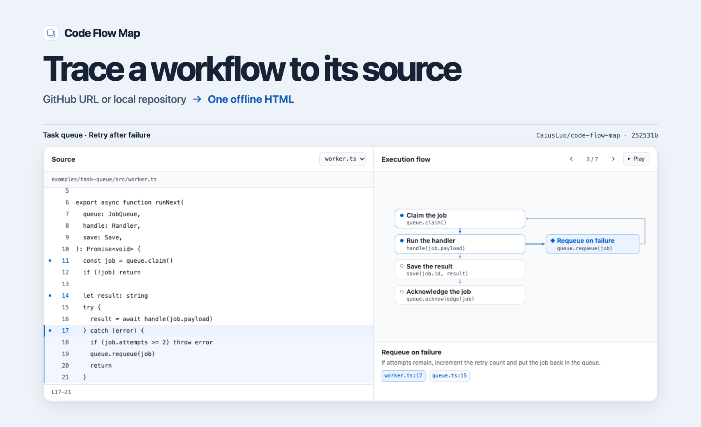
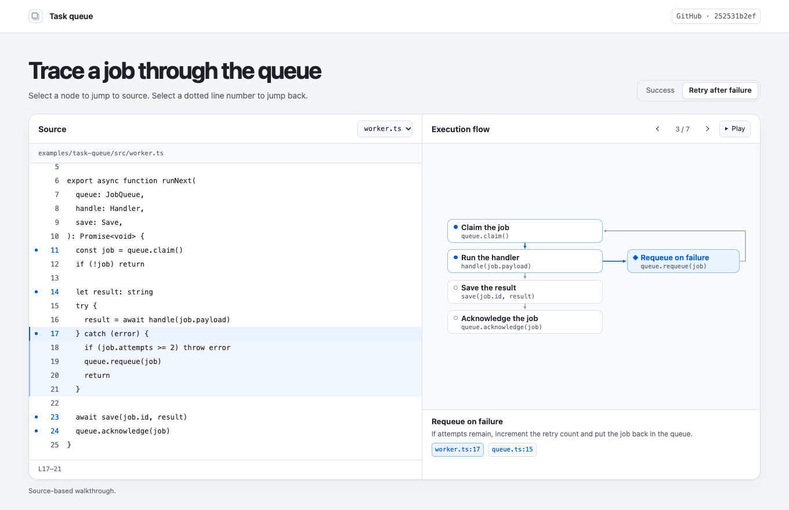
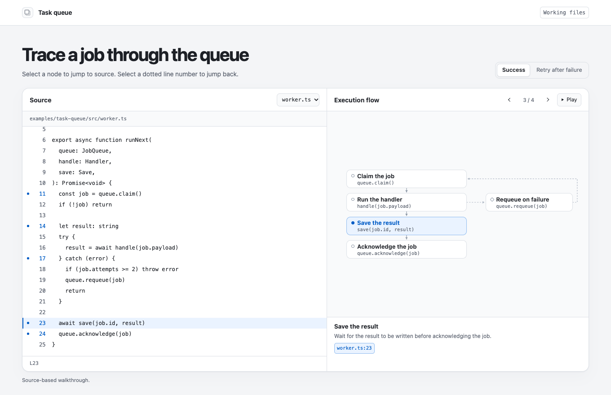

# Code Flow Map

**English** · [简体中文](README.zh-CN.md) · [Read the skill](skills/code-flow-map/SKILL.md)

Learn how a project works, one code path at a time. Give the skill a public GitHub repository or a local directory and get one interactive HTML walkthrough that links flow steps to source lines.

**[Open the interactive demo](https://caiusluo.github.io/code-flow-map/demo/)**. The retry branch opens with its source already highlighted.



## Quick start

After installing the skill, ask it a question about the path you want to understand.

> Use Code Flow Map with `https://github.com/CaiusLuo/code-flow-map`. What happens when a job fails in `examples/task-queue`? Show me where it retries and where it stops.

A public GitHub URL works without a local checkout. You can also give a local directory or specify a branch, tag, or commit. Open the generated HTML directly in a browser.

**Flow → source.** Click **Requeue on failure** to jump to `worker.ts` lines 17–21. The GitHub badge opens the exact source commit.



**Source → flow.** Click the marked line that calls `save` to highlight **Save the result**. Use **Play** or the step controls to follow the selected path.



## Video walkthrough

https://github.com/user-attachments/assets/fa17df5e-d21b-488a-b96a-a99b4205e0a4

*36-second walkthrough with Chinese captions, from source navigation to replaying a retry path.*

## Install

Rendering requires Python 3.9 or newer. Git is used to resolve branches and tags and read local commits. The HTML includes the full text of the source files it references.

### Codex and Claude Code

Run this in the target project:

```sh
npx skills add CaiusLuo/code-flow-map --skill code-flow-map --agent codex claude-code
```

Invoke `$code-flow-map` in Codex or `/code-flow-map` in Claude Code. For a manual install, put the full `code-flow-map` directory under the project's `.agents/skills/` for Codex or `.claude/skills/` for Claude Code. [Codex skills](https://learn.chatgpt.com/docs/build-skills) · [Claude Code skills](https://code.claude.com/docs/en/skills)

### DeepSeek Harness

Put the full `code-flow-map` directory under `.agents/skills/` or `.dsh/skills/` at the project root, then invoke `/code-flow-map`. Harness can reuse the same project-level `.agents/skills/` installation as Codex. [Harness skills](https://github.com/deepseek-ai/deepseek-harness/blob/master/docs/subsystems/skills.md)

### Pi

Install the Git package, then invoke `/skill:code-flow-map`.

```sh
pi install git:github.com/CaiusLuo/code-flow-map@main
```

[Pi packages](https://github.com/earendil-works/pi/blob/main/packages/coding-agent/docs/packages.md)

### Magpie

1. In **Library → Skills**, add `CaiusLuo/code-flow-map` from GitHub. Pick `code-flow-map` and the agents that should receive it.
2. If the Skill Router is enabled, use the command below to list it in `magpie-skills`. With direct installation, use the receiving agent's own invocation.

```sh
magpie library skill router code-flow-map routed
```

Run `magpie library skill router on` to enable the router for the whole Library. Each receiving agent decides when to invoke a skill. [Magpie Library](https://usemagpie.ai/docs/library#skills)

## Saved walkthroughs

The skill stores walkthroughs in `~/code-flow-map`. Manage them from chat.

- “List my saved Code Flow Maps” returns a table with links to open each walkthrough.
- “Delete the AOF walkthrough” moves the matching HTML to `~/code-flow-map/.trash`. To restore it, move the file back into `~/code-flow-map`.

## Run the example locally

The sample job queue demonstrates a successful run and a retry after failure. Run the renderer from the repository root.

```sh
python3 skills/code-flow-map/scripts/render.py \
  --repo examples/task-queue \
  --manifest examples/task-queue/flow.json
```

Open the HTML path printed by the renderer. To change a node or add a path, edit the [example manifest](examples/task-queue/flow.json) and render it again. [Manifest fields](skills/code-flow-map/references/manifest.md)

## License

[MIT](LICENSE)
