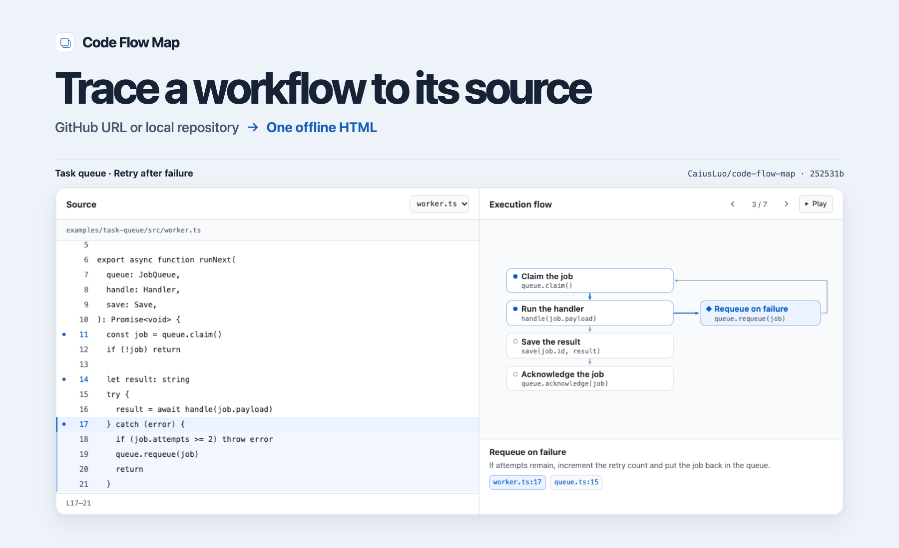
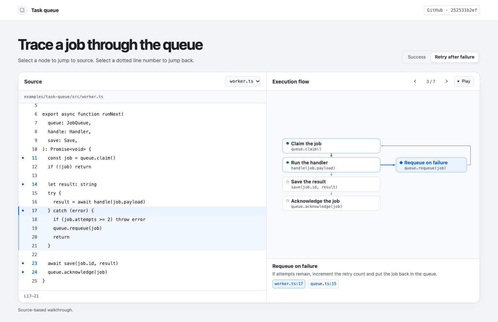
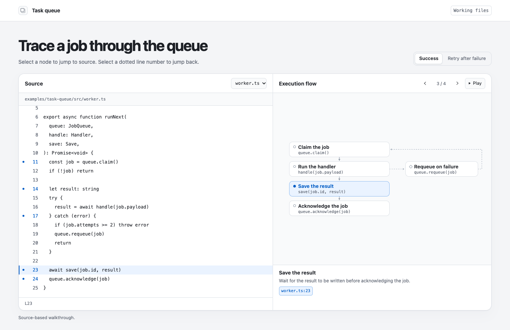

# Code Flow Map

[English](README.md) · **简体中文** · [阅读 Skill](skills/code-flow-map/SKILL.md)

给出公开 GitHub 仓库或本地目录，把一条执行流程做成可离线打开的 HTML。左侧读源码，右侧看流程，两边可以互相定位。



## 快速开始

把公开 GitHub 仓库链接或本地仓库路径交给 `code-flow-map`，再说明你想追踪哪条流程。直接给 GitHub 链接就可以，无需在本地克隆。也可以指定分支、标签或提交。

> 用 `code-flow-map` 看 `https://github.com/CaiusLuo/code-flow-map` 里的 `examples/task-queue`。梳理任务从领取到完成的流程，带上失败重试分支，生成一个能离线打开的 HTML。

如果你已经有本地副本，把链接换成目录即可，例如 `/path/to/code-flow-map`。

**流程 → 源码。** 点击「失败后重新入队」，左侧跳到 `worker.ts` 第 17–21 行。点击 GitHub 提交号可打开对应版本。



**源码 → 流程。** 点击调用 `save` 的带圆点行号，右侧高亮「保存结果」。可以播放或单步跟读选中的路径。



## 演示

https://github.com/user-attachments/assets/fa17df5e-d21b-488a-b96a-a99b4205e0a4

*36 秒使用演示，从源码定位到重试路径播放。*

## 安装

生成 HTML 需要 Python 3.9 或更新版本。解析分支、标签或读取本地提交需要 Git。HTML 包含所引用源码文件的全文。

### Codex 和 Claude Code

在目标项目目录执行：

```sh
npx skills add CaiusLuo/code-flow-map --skill code-flow-map --agent codex claude-code
```

在 Codex 输入 `$code-flow-map`，在 Claude Code 输入 `/code-flow-map`。如需手动安装，把完整的 `code-flow-map` 技能目录分别放到项目的 `.agents/skills/` 或 `.claude/skills/`。 [Codex 技能文档](https://learn.chatgpt.com/docs/build-skills) · [Claude Code 技能文档](https://code.claude.com/docs/en/skills)

### DeepSeek Harness

把完整的 `code-flow-map` 技能目录放到项目根目录的 `.agents/skills/` 或 `.dsh/skills/`，然后输入 `/code-flow-map`。如果已在同一项目为 Codex 安装到 `.agents/skills/`，可以直接复用。 [Harness 技能文档](https://github.com/deepseek-ai/deepseek-harness/blob/master/docs/subsystems/skills.md)

### Pi

用 Pi 的 Git 包安装，再输入 `/skill:code-flow-map`。

```sh
pi install git:github.com/CaiusLuo/code-flow-map@main
```

[Pi 包与安装文档](https://github.com/earendil-works/pi/blob/main/packages/coding-agent/docs/packages.md)

### Magpie

1. 打开 **Library → Skills**，从 GitHub 添加 `CaiusLuo/code-flow-map`，选择 `code-flow-map` 和要接收它的 Agent。
2. 如果已启用 Skill Router，运行下面的命令让这一项进入 `magpie-skills` 目录。采用直装时，可用接收方 Agent 自己的技能调用方式。

```sh
magpie library skill router code-flow-map routed
```

如果需要开启库级 Skill Router，可以运行 `magpie library skill router on`。这个开关作用于整个 Library，具体是否调用某项技能仍由接收技能的 Agent 决定。 [Magpie Library 文档](https://usemagpie.ai/docs/library#skills)

## 本地跑一个示例

示例任务队列演示首次成功和失败重试两条路径。在仓库根目录运行渲染命令。

```sh
python3 skills/code-flow-map/scripts/render.py \
  --repo examples/task-queue \
  --manifest examples/task-queue/flow.json \
  --out task-queue.html
```

在浏览器打开 `task-queue.html`。要调整节点或新增路径，修改 [示例清单](examples/task-queue/flow.json) 后重新生成。 [清单字段说明](skills/code-flow-map/references/manifest.md)

## 许可证

[MIT](LICENSE)
